<!--
  Andi Sakta Rifki (sktamalik): Fullstack Developer & Automation.
  Web applications, business process automation, interactive data dashboards, and agentic AI systems.
  Website: https://sktafolio.my.id
  LinkedIn: https://linkedin.com/in/andi-sakta-rifki-erlangga-malik-5852a9361
  Instagram: https://www.instagram.com/sktamalik_
  GitHub: https://github.com/sktamalik
-->

 

**Bonfire menu**

- **Level up**: explore projects, web applications and live systems on <a href="https://sktafolio.my.id">sktafolio.my.id</a>
- **Attune skills**: deploy fullstack web apps, zero-click Python & GAS automations, or interactive dashboards
- **Travel**: connect via <a href="https://linkedin.com/in/andi-sakta-rifki-erlangga-malik-5852a9361">LinkedIn</a>, <a href="https://www.instagram.com/sktamalik_">Instagram</a>, or <a href="https://github.com/sktamalik">GitHub</a>
- **Kindle**: star a repo you find helpful, it keeps the flame burning

  <b>Andi Sakta Rifki</b> builds modern <b>Fullstack Web Applications</b>, business process automations, and agentic AI systems. 
  Fullstack Developer · Automation Alchemist · Data & Dashboard. Based in Indonesia.

 

**Join the party.** Need a fullstack web platform, automated data pipeline, or custom operational bot? Let's build together.

##  About Me

Fullstack Developer and IT Automation based in Indonesia. Graduated with a Bachelor's degree in Informatics Engineering (S1 Teknik Informatika, GPA 3.83 / 4.00) and certified as a BNSP Data Scientist. Currently working as a **Web Programmer at RSUP Kemenkes Makassar**.

At RSUP Kemenkes Makassar, I develop and maintain mission-critical hospital information systems and healthcare digital services. My focus spans building internal web applications, patient and clinical service data management platforms, seamless API integrations, and real-time healthcare monitoring dashboards using **Node.js, Express.js, React, MySQL, and PostgreSQL**.

Beyond hospital systems, I engineer zero-click automated workflows (Python, Google Apps Script) that eliminate operational friction, and actively integrate **Agentic AI** with tools like Claude Code, Codex, Antigravity, and Hermes Agent to achieve 10x iteration velocity, architect maintainable modular architectures, and ensure bulletproof system reliability.

##  Developer Classes: Choose Your Specialization

Select the specialization for your quest. Every class delivers battle-tested code.

<table>
  <tr>
    <td width="50%" valign="top">
      
      
<b><a href="https://sktafolio.my.id">Fullstack Knight</a></b>: Robust, responsive web applications engineered with Laravel, React, Express.js, PHP, MySQL, and PostgreSQL.

    </td>
    <td width="50%" valign="top">
      
      
<b><a href="https://sktafolio.my.id">Automation Alchemist</a></b>: Python automation, Google Apps Script integrations, and bots that turn tedious manual routines into zero-click workflows.

    </td>
  </tr>
  <tr>
    <td width="50%" valign="top">
      
      
<b><a href="https://sktafolio.my.id">Metrics Oracle</a></b>: Interactive dashboards, business intelligence reporting, and clear visual data storytelling certified by BNSP Data Science.

    </td>
    <td width="50%" valign="top">
      
      
<b><a href="https://sktafolio.my.id">AI Artificer</a></b>: 10x development velocity through autonomous agent workflows, utilizing Claude Code, Codex, and Antigravity.

    </td>
  </tr>
</table>

##  Boss Fight

<picture></picture>

 

**The Legacy Monolith & Chaotic Spreadsheets.** Weakness: Clean fullstack architecture, automated Python/GAS pipelines, real-time dashboards, and agentic development velocity.

**Ready to defeat manual inefficiencies?** Check out my live projects on <a href="https://sktafolio.my.id"><b>sktafolio.my.id</b></a> or reach out directly to build tailored software solutions.

##  FAQ

<b>Who is Andi Sakta Rifki?</b>

 
A Fullstack Developer and Automation from Indonesia. Currently serving as a Web Programmer at RSUP Kemenkes Makassar, he builds mission-critical hospital information systems, healthcare data dashboards, and automated digital workflows. With an academic background in Informatics Engineering (GPA 3.83/4.00) and BNSP Data Scientist certification, he translates complex healthcare and operational requirements into secure, robust software. Portfolio: <a href="https://sktafolio.my.id">sktafolio.my.id</a>.

<b>What services and technical solutions do you provide?</b>

 
1. <b>Fullstack Web Development</b>: Custom web systems and platforms using Laravel, React, Express.js, PHP, and modern relational databases (MySQL & PostgreSQL). 
2. <b>Workflow & Business Automation</b>: Python scripts, Google Apps Script macros, spreadsheet-to-database pipelines, and API integrations. 
3. <b>Data Dashboards & Visualization</b>: Executive dashboards and analytics interfaces designed to transform complex data into actionable insights. 
4. <b>Agentic AI Workflows</b>: Rapid prototyping, testing, and system development utilizing autonomous AI developer tooling.

<b>What is your educational and professional background?</b>

 
He holds a Bachelor's Degree in Informatics Engineering (S1 Teknik Informatika) with a 3.83/4.00 GPA, and is certified as a BNSP Data Scientist. Professionally, he serves as a Web Programmer at RSUP Kemenkes Makassar developing hospital web applications, clinical service data systems, and monitoring dashboards using Node.js, Express.js, and React.

<b>How does your automation process work?</b>

 
We identify repetitive operational friction points—such as manual data entry, disconnected spreadsheets, or routine reporting tasks. Using Python, Google Apps Script, and REST APIs, these workflows are automated into self-running pipelines that trigger automatically, validate data, and alert stakeholders.

<b>How do you integrate Agentic AI in software development?</b>

 
By integrating cutting-edge agentic tools such as Claude Code, Codex, Antigravity, and Hermes Agent directly into the dev loop. This enables high-velocity code authoring, automated test coverage generation, systematic refactoring, and rapid delivery without sacrificing code quality.

<b>How can we collaborate or get in touch?</b>

 
You can explore featured projects at <a href="https://sktafolio.my.id">sktafolio.my.id</a>, connect professionally on <a href="https://linkedin.com/in/andi-sakta-rifki-erlangga-malik-5852a9361">LinkedIn</a>, or reach out via Instagram <a href="https://www.instagram.com/sktamalik_">@sktamalik_</a>.

##  Tech Stack

##  Connect

  
  
  
  

